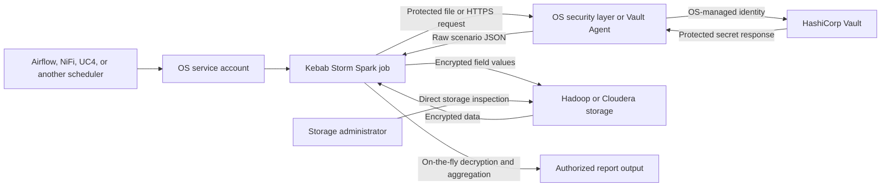

# Kebab Storm
## Introduction

Kebab Storm is a handcrafted Apache Spark project designed to demonstrate how sensitive data can be refined,
validated, transformed, selectively encrypted, and stored in a Hadoop-oriented data platform. Its central idea is to
keep configured fields encrypted at rest as binary values so that directly inspecting the underlying Parquet files or
Hadoop storage does not expose readable personal or commercially sensitive information—even to administrators who
have access to the storage layer but do not have access to the encryption keys and authorized application path.

The same protected data can still be useful. Spark jobs decrypt the required fields on the fly when an authorized
reader prints imported records or generates an aggregated report. This demonstrates a separation between storage and
data use: the persisted dataset remains unreadable at the field level, while reporting logic can decrypt only during
processing and produce meaningful totals, groupings, and other analytics. Anyone who can access the application keys
or the decryption runtime can, of course, recover the protected values; this example does not claim to protect data
from an administrator who also controls those assets.

Kebab Storm was also motivated by the role of encryption in personal-data protection. Encryption is recognized as a
technical security measure under [Article 32 of the GDPR](https://eur-lex.europa.eu/legal-content/EN/ALL/?uri=celex%3A32016R0679),
while official [KVKK data-security guidance](https://www.kvkk.gov.tr/Icerik/2040/Veri-Guvenligine-Iliskin-Yukumlulukler)
similarly identifies encryption, access control, secure key management, and appropriate technical and administrative
measures as parts of protecting personal data. Demonstrating how sensitive data can remain protected at the storage
layer while still supporting authorized Spark processing and reporting was one of the reasons for developing this
project.

Kebab Storm does not make an organization or deployment GDPR-compliant or KVKK-compliant by itself. Compliance
depends on the complete processing environment, including lawful processing, data minimization, retention, identity
and access management, network security, key management, monitoring, incident response, data-subject rights, and
organizational policies. Encrypted values also remain personal data while authorized parties can decrypt them. The
framework should therefore be understood as a compliance-supporting technical control and reference implementation,
not compliance certification or legal evidence.

The scenario files included in this repository are demonstration examples. Because an encrypted-field definition
contains the corresponding AES key, production scenarios must not be stored in the source repository or an
unprotected shared filesystem. In a real deployment, complete scenarios should be stored in HashiCorp Vault—or an
equivalent managed secrets system—and retrieved only by the authorized operating-system service identity over a
protected HTTPS or Vault Agent path. Access to scenario contents must be audited and restricted independently from
access to the encrypted Parquet or Iceberg data. This separation is essential: anyone who obtains both the encrypted
dataset and its scenario keys can decrypt the protected fields.

Processing behavior is described by JSON scenarios rather than hard-coded for one dataset. A scenario defines source
and mapped field names, type conversions, encryption choices and keys, storage locations, partitioning, schema
enforcement, and retention. The project also demonstrates data-quality handling, encrypted and decrypted reads,
report generation with on-the-fly decryption, and row-level soft and hard deletion governed by a configured retention
period.

**This repository is a technical reference implementation, not a turnkey production security product.** It can form
part of a production service when the surrounding platform supplies secure identity, secret management, authorization,
auditing, monitoring, recovery, and restricted access to the Spark runtime. Those controls are deployment
responsibilities and are intentionally outside this project.

### Encryption Format

Encrypted scenario fields use **AES-256-GCM**, an authenticated-encryption mode that provides confidentiality and
detects accidental or malicious ciphertext modification. AES-256 is often marketed as “military-grade” encryption;
the precise and more useful claim here is that Kebab Storm uses a 256-bit AES key with GCM authentication. Overall
security still depends on key protection, operating-system controls, Spark-runtime access, configuration, and sound
operations—not the cipher name alone.

Ciphertext is produced by Spark's native `aes_encrypt` expression and stored directly in `BinaryType` columns rather
than encoded as Base64 text. GCM uses a fresh random 12-byte initialization vector for every value and Spark prepends
that vector to its authenticated binary output. Re-encrypting the same value therefore produces different bytes.
Authentication failure prevents altered or incorrectly keyed values from being silently decrypted. Each encrypted
value is also authenticated with its mapped column name as additional authenticated data, so ciphertext moved to a
different field cannot be successfully decrypted there.

Every encrypted field requires its own unique 256-bit random key, represented in scenario JSON as exactly 64
hexadecimal characters. This encoding represents 32 random bytes without reducing their entropy. Scenario validation
rejects malformed, shorter, longer, or reused keys. Fields with `"is_encrypted": false` omit `encryption_key`
entirely; empty or placeholder keys are not used. In a service deployment, real keys should be delivered through the
protected scenario/Vault path described below. Encryption and decryption run as native Spark SQL expressions inside
the JVM execution engine, avoiding Python UDF calls and per-row scenario parsing. Spark's native AES-256-GCM binary
format is not compatible with either the former custom AES-256-GCM envelope or the earlier AES-128-CBC/Base64 format;
data written by either former implementation must be removed and imported again.

### Service Deployment Architecture

Kebab Storm can run as a controlled Spark service in a Hadoop or Cloudera environment. Apache Airflow, Apache NiFi,
UC4, or another enterprise scheduler starts an executor under a dedicated operating-system service account. That
identity retrieves the scenario from HashiCorp Vault over HTTPS, runs the requested import or report, and accesses
only the storage paths and secrets assigned to it.

Security integration and task scheduling are deliberately kept outside the Kebab Storm source code. The operating
system and deployment platform own service identity, certificates, tokens, Vault authentication, process permissions,
and Spark submission. The external orchestrator owns calendars, dependencies, and retries. Kebab Storm receives a
scenario location and execution arguments, then performs only the requested data operation. This separation keeps the
application small, platform-neutral, and independent of a particular secret manager or scheduling product; it is an
architectural choice rather than missing application functionality.



In this model, users or administrators with storage-layer access can inspect files and partitions but cannot read the
encrypted fields. The Spark service decrypts protected values only while executing an authorized operation. Access to
the service account, Vault identity, Spark driver and executor processes, Spark UI, event logs, and generated report
locations must be restricted at the operating-system and platform level. An administrator who controls that trusted
runtime is outside this protection boundary because the runtime must receive the keys to perform decryption.

#### Vault Scenario Retrieval

All scenario consumers already use `load_scenario()` in [`util/scenario_util.py`](util/scenario_util.py), so Vault
integration is isolated to that function. The remaining ETL and reporting code does not need to know whether a
scenario came from a local file, an HTTPS service, or Vault. Retrieved scenarios still pass through the same JSON
Schema and semantic validation before execution.

The selected architecture uses an OS-managed Vault Agent or internal secret adapter, and the current HTTPS
implementation expects that component to return the scenario JSON directly. No Python change is required when it:

- Authenticates to Vault using the machine or service identity.
- Renews its short-lived credentials outside the Spark application.
- Exposes the authorized secret through a protected local HTTPS endpoint or renders it as a protected file.
- Returns the scenario itself rather than the standard Vault response envelope.

Vault authentication is intentionally not implemented inside Kebab Storm. Tokens and private keys are not application
arguments, scenario properties, or scheduler parameters; the OS security layer owns them. A future direct-Vault mode
would require changing only the URL branch of `load_scenario()` to authenticate and unwrap the Vault response, but
that is not required for this architecture and would couple the application to Vault.

After retrieval, the current implementation supplies the scenario to Spark encryption UDFs. Under this deployment
model, the Spark runtime—including its UI and event logs—is part of the trusted service boundary and must be accessible
only to authorized operators. If Spark administrators must also be prevented from accessing keys, the implementation
would require a different key-handling design rather than placing encryption keys directly in the scenario.

#### Task Scheduling and Orchestration

Kebab Storm deliberately contains no internal scheduler. Apache Airflow, Apache NiFi, UC4, or a similar orchestration
platform can execute the existing command-line modules through `spark-submit` or the environment's approved Spark
submission mechanism. A typical scheduled workflow is:

1. Confirm that the source data is available and complete.
2. Run `etl.executor.import` with the secured scenario URL, input location, and logical processing date.
3. Run the required reporting module after a successful import.
4. Publish or transfer only the approved report output.
5. Run `etl.executor.hard_delete` on a separate retention schedule.
6. Record the result and notify operators when a task fails.

Soft deletion is normally triggered by an approved deletion request and invokes `etl.executor.soft_delete` with the
authorized record identifiers. Hard deletion is a periodic maintenance task that applies the retention period from the
same scenario. Import and report dates should come from the scheduler's logical execution date so retries process the
same partition instead of automatically switching to the retry date.

The orchestrator supplies task dependencies, calendars, retries, concurrency limits, service-account selection,
credential renewal, notifications, and operational history. Kebab Storm remains responsible for scenario validation,
data conversion, encryption, storage, retention execution, and report generation. No Kebab Storm code change is
required specifically for Airflow, NiFi, or UC4 integration.

## Setup (Spark & Hadoop on localhost)
### Windows
Please use this [link](https://phoenixnap.com/kb/install-spark-on-windows-10).
### Mac
Please use this [link](https://sparkbyexamples.com/spark/install-apache-spark-on-mac/).
## External Dependencies (requirements.txt)
```sh
pyspark==4.1.1
confuse==2.2.0
jsonschema==4.26.0
PyYAML==6.0.3
typing-extensions==4.16.0
validators==0.35.0
python-dateutil==2.9.0.post0
```

The current runtime baseline is Python 3.10 or newer and Java 17 or newer. The local PySpark version must match the
target Spark cluster version.
## Driver Settings
All necessary Spark and solution specific settings are located in [/conf](https://github.com/egulay/kebab_storm/tree/master/conf) directory per environment.

Select the runtime environment with `KEBAB_STORM_ENV`. It accepts `local`, `dev`, or `prod` and safely defaults to
`local` when it is not set:

```sh
KEBAB_STORM_ENV=local python -m etl.executor.import ...
```

Shared Spark settings are defined in [`conf/default.yml`](conf/default.yml), then recursively merged with the selected
[`conf/local/env.yml`](conf/local/env.yml), `conf/dev/env.yml`, or `conf/prod/env.yml`. Runtime values have this
precedence: shared YAML, environment YAML, environment-variable overrides, then command-line arguments.

The following optional environment variables avoid editing YAML during deployment:

```text
KEBAB_STORM_SPARK_MASTER
KEBAB_STORM_LOGGING_LOCATION
KEBAB_STORM_DATA_LOCATION
KEBAB_STORM_STORAGE_PROVIDER
```

Each command creates Spark explicitly after parsing its arguments and always stops the session when the job finishes.
Deployment-time properties such as driver memory and deploy mode should be supplied through `spark-submit`;
environment YAML is reserved for settings that the application can apply while constructing its Spark session.

### Storage Provider

Kebab Storm always writes Parquet as the physical data-file format. The active environment YAML selects whether those
files are unmanaged raw Parquet or managed as Apache Iceberg tables:

```yaml
storage_provider: "parquet"
iceberg_catalog: "kebab"
iceberg_namespace: "default"
```

`parquet` is the default and preserves the filesystem and year-folder behavior used by the demos. `iceberg` keeps one
logical catalog table for each scenario location, uses Parquet underneath, and lets Iceberg manage table metadata,
snapshots, and partitions. Storage technology is intentionally not defined in a scenario because it belongs to the
Spark environment rather than the dataset contract.

An Iceberg environment must configure its catalog and provide the matching JVM runtime. For the current Spark 4.1
baseline, a local Hadoop-catalog example is:

```yaml
storage_provider: "iceberg"
iceberg_catalog: "kebab"
iceberg_namespace: "default"

spark_config:
  spark.sql.extensions: "org.apache.iceberg.spark.extensions.IcebergSparkSessionExtensions"
  spark.sql.catalog.kebab: "org.apache.iceberg.spark.SparkCatalog"
  spark.sql.catalog.kebab.type: "hadoop"
  spark.sql.catalog.kebab.warehouse: "/data/kebab_storm/iceberg"
```

Supply `org.apache.iceberg:iceberg-spark-runtime-4.1_2.13:1.11.0` through the managed cluster installation,
`spark-submit --packages`, or `spark.jars.packages`; it is a JVM dependency and therefore does not belong in
`requirements.txt`. A Cloudera deployment can replace the Hadoop catalog settings with its Hive or REST catalog
configuration without changing the scenarios or Python executors.

Iceberg hard deletion removes rows from the current snapshot. The platform retention schedule must also expire old
snapshots and remove orphan files when physical removal is required; otherwise older snapshots may continue to
reference deleted encrypted records.

### Source Filesystems and Input Cleanup

Spark can read input paths from the local filesystem, HDFS, S3-compatible storage through `s3a://`, and Apache Ozone
through `ofs://` or `o3fs://`. The corresponding Hadoop filesystem connector, credentials, endpoint, and cluster
configuration must be supplied to Spark by the deployment environment.

A scenario can request removal of its source path after the encrypted storage write completes successfully:

```json
"delete_input_file_after_import": false
```

Keep this `false` by default. Set it to `true` only for extremely sensitive input data in a controlled ingestion
location where permanent source removal is required by the applicable retention policy. The importer deletes the exact
CSV file through the Hadoop filesystem API; directories and glob paths are not accepted for deletion. A failed read,
validation, encryption, or destination write leaves the input untouched. On versioned or snapshot-enabled object
stores, deletion may create a delete marker or remove only the current view, so lifecycle and retention policies remain
the platform administrator's responsibility. This option cannot be combined with `import_mode: "ignore"`, because an
existing destination may cause Spark to skip the write rather than import the source file.

## Features
Executor scripts are located in [/etl/executor/](https://github.com/egulay/kebab_storm/tree/master/etl/executor) directory with the features below:
* [Encrypt & Import](https://github.com/egulay/kebab_storm/blob/master/etl/executor/import.py)
* [Print Imported](https://github.com/egulay/kebab_storm/blob/master/etl/executor/print_imported.py)
* [Print Sample Data with Schema](https://github.com/egulay/kebab_storm/blob/master/etl/executor/print_sample_data_with_schema.py)
* [Print Soft Deleted](https://github.com/egulay/kebab_storm/blob/master/etl/executor/print_soft_deleted.py)
* [Refine & Print](https://github.com/egulay/kebab_storm/blob/master/etl/executor/refine_and_print.py)
* [Soft Delete](https://github.com/egulay/kebab_storm/blob/master/etl/executor/soft_delete.py)
* [Hard Delete](https://github.com/egulay/kebab_storm/blob/master/etl/executor/hard_delete.py)
### Scenario
An example JSON based scenario located in [/scenario](https://github.com/egulay/kebab_storm/blob/master/scenario/sales_records_scenario.json) directory.

Every scenario is structurally validated against the Draft 2020-12 schema in
[`scenario/schema/kebab_storm_scenario.schema.json`](scenario/schema/kebab_storm_scenario.schema.json). Validation
runs when the scenario is loaded, before Spark reads an input file. Structural validation is followed by semantic
checks for conversion definitions, duplicate mappings, reserved fields, ID-field membership, and encryption-key
rules. A structural error includes its JSON path, for example `$.fields[0].is_encrypted`.

Field conversions use a source-to-target pipe definition:

```text
source_type|target_type|option=value|option=value
```

Supported types are `string`, `boolean`, `byte`, `short`, `integer`, `long`, `float`, `double`,
`decimal(precision,scale)`, `date`, and `timestamp`. The aliases `bool`, `tinyint`, `smallint`, `int`, and `bigint`
are also accepted.

Examples:

```json
"type": "string|integer"
"type": "integer|string"
"type": "string|decimal(12,2)"
"type": "string|timestamp|source_format=%m/%d/%Y %H:%M:%S"
"type": "timestamp|string|source_format=%Y-%m-%d|target_format=%d/%m/%Y"
"type": "long|timestamp|epoch_unit=milliseconds"
"type": "timestamp|long|source_format=%Y-%m-%d %H:%M:%S|epoch_unit=seconds"
"type": "string|boolean|true_values=yes,y,1|false_values=no,n,0"
"type": "boolean|string|true_value=YES|false_value=NO"
```

Numeric/timestamp conversions require `epoch_unit=seconds`, `milliseconds`, or `microseconds`. Numeric-to-boolean
conversion accepts only `0` and `1`. Invalid or overflowing values are converted to null and summarized in the logs.
CSV cells are initially read as strings so the scenario remains the schema authority.

For flexible and concise scenarios, the string source may be omitted. Shorthand definitions such as `int`, `double`,
and `timestamp|%m/%d/%Y|%Y-%m-%d` are interpreted as string-to-target conversions.

```json
{
  "entity_name": "Sales",
  "import_save_location": "/Sales",
  "report_save_location": "/Sales_Reports",
  "temp_save_location": "/Users/emregulay/tmp/Sales",
  "import_mode": "append",
  "delete_input_file_after_import": false,
  "id_field": "Order_ID",
  "delimiter": ",",
  "hard_delete_condition_in_years": 3,
  "enforce_data_model": true,
  "is_apply_year_to_save_location": true,
  "fields": [
    {
      "name": "Region",
      "map_as": "REGION",
      "type": "string|string",
      "encryption_key": "271757a442fd5ded08b42f3bfa99ce8ba6527d94e944092e95398842841b3d6d",
      "is_encrypted": true
    },
    {
      "name": "Country",
      "map_as": "COUNTRY",
      "type": "string|string",
      "encryption_key": "9d861f1293a83372a984126dcf57c5ffd1ed2f474e72383057894c68cc77e82a",
      "is_encrypted": true
    },
    {
      "name": "Item_Type",
      "map_as": "ITEMTYPE",
      "type": "string|string",
      "encryption_key": "07e9dcf3db0a3a8998f291b033516b6687c625d848a1746ead5736cf9fa61d54",
      "is_encrypted": true
    },
    {
      "name": "Sales_Channel",
      "map_as": "SALESCHANNEL",
      "type": "string|string",
      "is_encrypted": false
    },
    {
      "name": "Order_Priority",
      "map_as": "ORDERPRIORITY",
      "type": "string|string",
      "is_encrypted": false
    },
    {
      "name": "Order_Date",
      "map_as": "ORDERDATE",
      "type": "string|timestamp|source_format=%m/%d/%Y",
      "encryption_key": "1d720486235fe4346e1c56f91ddfb9283050e9ceefa3488c66040b016997ed04",
      "is_encrypted": true
    },
    {
      "name": "Order_ID",
      "map_as": "ORDERID",
      "type": "string|integer",
      "encryption_key": "b46b6cf63d7b24517ac76df54d41f8268a70f2c3bd3160df222076b8cb968ba4",
      "is_encrypted": true
    },
    {
      "name": "Ship_Date",
      "map_as": "SHIPDATE",
      "type": "string|timestamp|source_format=%m/%d/%Y",
      "encryption_key": "ddeff9673e9c58469426c764bef228a4170ee1ea767e6933e35725da58b41478",
      "is_encrypted": true
    },
    {
      "name": "Units_Sold",
      "map_as": "UNITSOLD",
      "type": "string|integer",
      "encryption_key": "91e5cbe97d1d36f3185f73e519b84bb1b67bb0f8ad509713249dfacabe59f244",
      "is_encrypted": true
    },
    {
      "name": "Unit_Price",
      "map_as": "UNITPRICE",
      "type": "string|double",
      "is_encrypted": false
    },
    {
      "name": "Unit_Cost",
      "map_as": "UNITCOST",
      "type": "string|double",
      "encryption_key": "dda0f3de76ea16273b64b87c05e279a237ab12edaa0ef977ac407e7a70acccc1",
      "is_encrypted": true
    },
    {
      "name": "Total_Revenue",
      "map_as": "TOTALREVENUE",
      "type": "string|double",
      "encryption_key": "dfa290847a65690752f0e9983dbdaba7a369ef02dd28bacaea1e3bc649fe7876",
      "is_encrypted": true
    },
    {
      "name": "Total_Cost",
      "map_as": "TOTALCOST",
      "type": "string|double",
      "encryption_key": "087117eff5071aff926e8378d2267c315b687b5a1c709eb5b68b04ae7d31ef95",
      "is_encrypted": true
    },
    {
      "name": "Total_Profit",
      "map_as": "TOTALPROFIT",
      "type": "string|double",
      "encryption_key": "fca2c98e20ba07e2f1f379430b4d74b533811d4c6978bae9e5d028bcf9accbf4",
      "is_encrypted": true
    }
  ]
}
```

### Sales Demo Scripts

The [`demo/sales`](demo/sales) directory contains an end-to-end sales demonstration. Run the scripts from the project
root in numeric order:

```sh
./demo/sales/01_import.sh
./demo/sales/02_print_imported_encrypted.sh
./demo/sales/03_print_imported_decrypted.sh
./demo/sales/04_create_report.sh
./demo/sales/05_print_report.sh
```

The flow imports the corrupted sales sample, displays the encrypted-at-rest values, decrypts them while reading,
creates the simple sales aggregation with on-the-fly decryption, and prints the generated report.

Every script automatically sources [`demo/sales/demo_env.sh`](demo/sales/demo_env.sh). It locates the project root and
exports the Java, Python, PySpark, Spark master, timezone, configuration profile, data location, logging location,
scenario, input file, import date, report date, and soft-delete settings required by the demo. Generated Parquet data
and logs are written to `demo/output` and `demo/logs`.

Defaults can be overridden for an individual run without editing a script:

```sh
DEMO_IMPORT_DATE=2026-08-01 ./demo/sales/01_import.sh
DEMO_IMPORT_DATE=2026-08-01 ./demo/sales/04_create_report.sh
```

`05_print_report.sh` uses the current date because reports are partitioned by their creation date. Override
`DEMO_REPORT_DATE` when printing a report created on another day.

To reset the demonstrations, run the root-level cleanup script:

```sh
./demo/reset.sh
```

The script removes the shared `demo/output` and `demo/logs` directories, clearing generated sales and health import
data, reports, and application logs. Scenario files and source CSV files are not changed. The script intentionally
targets only the default demo directories; output locations supplied through custom environment overrides must be
cleaned separately.

#### Demonstrating Soft and Hard Delete Retention

The sales scenario sets `hard_delete_condition_in_years` to `3`. A normal soft delete records today's date, so an
immediately following hard delete correctly keeps the record: it has not completed its three-year retention period.
To demonstrate the complete lifecycle without waiting three years, temporarily backdate the soft-delete date in two
places. These changes are for the retention demo only and must be restored afterward.

In [`util/etl_util.py`](util/etl_util.py), uncomment the retention-demo `relativedelta` import and the backdated block
inside `generic_soft_delete()`. Comment the active three-line block that assigns, logs, and returns today's
`soft_deleted` value.

When `storage_provider` is `parquet`, also uncomment the retention-demo block in `soft_delete()` in
[`etl/importer.py`](etl/importer.py) and comment the active `today = datetime.today()...` line immediately below it.
This second switch lets raw Parquet select and overwrite the affected year folder. Without it, the backdated row exists
in temporary data but its source partition is not selected for overwrite. Iceberg replaces the affected logical table
without this filesystem-year lookup, so its retention demo requires only the `generic_soft_delete()` date switch.

Hard delete also scans year-based import locations only through the retention cutoff year. Therefore, import this demo
with a date at least three years old. For example, when running on `2026-07-21`, use `2023-07-21`:

```sh
export DEMO_IMPORT_DATE=2023-07-21
source demo/sales/demo_env.sh

./demo/sales/01_import.sh

"${DEMO_PYTHON}" -m etl.executor.soft_delete \
  --scenario "${DEMO_SCENARIO}" \
  --id_values 897751939

"${DEMO_PYTHON}" -m etl.executor.print_soft_deleted \
  --scenario "${DEMO_SCENARIO}" \
  --crypto-action decrypted

"${DEMO_PYTHON}" -m etl.executor.hard_delete \
  --scenario "${DEMO_SCENARIO}"
```

The soft-deleted print confirms that the record was marked and decrypted on read. The hard-delete execution then
physically removes records whose `SOFT_DELETED` value is on or before the three-year cutoff. After the demonstration,
re-comment the retention-demo import and backdating blocks, then restore the active current-date lines. Otherwise,
future soft deletes will be immediately eligible for hard deletion.

### Execution
#### Help
Each executor file has help text similar to below.
```sh
import.py --help
```
```sh
 ____  __.    ___.         ___.     _________ __
|    |/ _|____\_ |__ _____ \_ |__  /   _____//  |_  ___________  _____
|      <_/ __ \| __ \\__  \ | __ \ \_____  \\   __\/  _ \_  __ \/     \
|    |  \  ___/| \_\ \/ __ \| \_\ \/        \|  | (  <_> )  | \/  Y Y  \
|____|__ \___  >___  (____  /___  /_______  /|__|  \____/|__|  |__|_|  /
        \/   \/    \/     \/    \/        \/                         \/
usage: import.py [-h] --scenario /path/to/scenario.json OR
                 https://domain.com/scenario-id --input-file
                 /path/to/input_file.csv --date 2020-01-01

Kebab Storm: A Spark driver demonstrating native Spark AES-256-GCM cryptography
with data quality checks based on ETL scenarios in JSON format

optional arguments:
  -h, --help            show this help message and exit

required arguments:
  --scenario /path/to/scenario.json OR https://domain.com/scenario-id, -scn /path/to/scenario.json OR https://domain.com/scenario-id
                        Scenario JSON file path or URL
  --input-file /path/to/input_file.csv, -if /path/to/input_file.csv
                        File to import
  --date 2020-01-01, -d 2020-01-01
                        Import date in YYYY-MM-DD format
```
#### Encrypt & Import

The console transcripts below are retained as historical sales demonstrations. Spark versions, timestamps, conversion
warnings, and ciphertext bytes vary in current runs. AES-256-GCM payloads use Spark's native binary representation and
are not Base64 encoded.

```sh
import.py --scenario ../../scenario/sales_records_scenario.json --input-file ../../data/50k_sales_records_corrupted.csv --date 2020-02-23
```

```sh
 ____  __.    ___.         ___.     _________ __
|    |/ _|____\_ |__ _____ \_ |__  /   _____//  |_  ___________  _____
|      <_/ __ \| __ \\__  \ | __ \ \_____  \\   __\/  _ \_  __ \/     \
|    |  \  ___/| \_\ \/ __ \| \_\ \/        \|  | (  <_> )  | \/  Y Y  \
|____|__ \___  >___  (____  /___  /_______  /|__|  \____/|__|  |__|_|  /
        \/   \/    \/     \/    \/        \/                         \/
2022-05-20 09:28:53,256 - etl.executor - INFO - ###### KEBAB STORM STARTED | Active YAML Configuration: local on Spark 3.0.1 with application ID local-1653028131680 ######
2022-05-20 09:28:53,265 - etl.importer - INFO - Active action: Encrypt & Import for Sales entity defined in ../../scenario/sales_records_scenario.json on day=20200223
2022-05-20 09:28:59,561 - etl.importer - INFO - Raw data loaded from ../../data/50k_sales_records_corrupted.csv for Sales entity
2022-05-20 09:28:59,562 - etl.refiner - INFO - Refinement will be applied to following column(s): Region, Country, Item_Type, Sales_Channel, Order_Priority, Order_Date, Order_ID, Ship_Date, Units_Sold, Unit_Price, Unit_Cost, Total_Revenue, Total_Cost, Total_Profit
2022-05-20 09:29:00,481 - etl.importer - INFO - Data refinement and validation applied for Sales entity
2022-05-20 09:29:00,482 - etl.crypter - INFO - Encryption will be applied to following mapped column(s): REGION, COUNTRY, ITEMTYPE, ORDERDATE, ORDERID, SHIPDATE, UNITSOLD, UNITCOST, TOTALREVENUE, TOTALCOST, TOTALPROFIT
2022-05-20 09:29:00,953 - etl.importer - INFO - Cryptography applied for Sales entity
2022-05-20 09:29:00,953 - etl.importer - INFO - Save as parquet started. Import mode: append
2022-05-20 09:29:04,229 - etl.refiner - WARNING - On column Total_Profit with Order_ID: 897751939 has corrupted value. 59c7290.92 cannot be parsable to Spark double. Null value is assigned for that cell.
2022-05-20 09:29:04,230 - etl.refiner - WARNING - On column Total_Cost with Order_ID: 599480426 has corrupted value. 13c44707.70 cannot be parsable to Spark double. Null value is assigned for that cell.
2022-05-20 09:29:04,232 - etl.refiner - WARNING - On column Total_Revenue with Order_ID: 538911855 has corrupted value. 204g5322.72 cannot be parsable to Spark double. Null value is assigned for that cell.
2022-05-20 09:29:04,233 - etl.refiner - WARNING - On column Ship_Date with Order_ID: 459845054 has corrupted value. 3/2j/2012 cannot be parsable to Spark timestamp. Null value is assigned for that cell.
2022-05-20 09:29:31,770 - etl.importer - INFO - Save as parquet finished with partition day=20200223 Import mode: append
2022-05-20 09:29:31,771 - etl.executor - INFO - C:/Users/emreg/PycharmProjects/kebab_storm/etl/executor/import.py executed in 38.53 seconds
```
#### Print Imported Data
##### Encrypted
```sh
print_imported.py --scenario ../../scenario/sales_records_scenario.json --crypto-action encrypted --date 2020-02-23
```
```sh
 ____  __.    ___.         ___.     _________ __
|    |/ _|____\_ |__ _____ \_ |__  /   _____//  |_  ___________  _____
|      <_/ __ \| __ \\__  \ | __ \ \_____  \\   __\/  _ \_  __ \/     \
|    |  \  ___/| \_\ \/ __ \| \_\ \/        \|  | (  <_> )  | \/  Y Y  \
|____|__ \___  >___  (____  /___  /_______  /|__|  \____/|__|  |__|_|  /
        \/   \/    \/     \/    \/        \/                         \/
2022-05-20 09:36:19,436 - etl.executor - INFO - ###### KEBAB STORM STARTED | Active YAML Configuration: local on Spark 3.0.1 with application ID local-1653028577542 ######
2022-05-20 09:36:19,447 - etl.printer - INFO - Active action: Print imported data for Sales entity defined in ../../scenario/sales_records_scenario.json on day=20200223
root
 |-- REGION: binary (nullable = true)
 |-- COUNTRY: binary (nullable = true)
 |-- ITEMTYPE: binary (nullable = true)
 |-- SALESCHANNEL: string (nullable = true)
 |-- ORDERPRIORITY: string (nullable = true)
 |-- ORDERDATE: binary (nullable = true)
 |-- ORDERID: binary (nullable = true)
 |-- SHIPDATE: binary (nullable = true)
 |-- UNITSOLD: binary (nullable = true)
 |-- UNITPRICE: double (nullable = true)
 |-- UNITCOST: binary (nullable = true)
 |-- TOTALREVENUE: binary (nullable = true)
 |-- TOTALCOST: binary (nullable = true)
 |-- TOTALPROFIT: binary (nullable = true)
 |-- DATE_IMPORTED: string (nullable = true)
 |-- SOFT_DELETED: timestamp (nullable = true)
 |-- YEAR_IMPORTED: integer (nullable = true)

+--------------------+--------------------+--------------------+------------+-------------+--------------------+--------------------+--------------------+--------------------+---------+--------------------+--------------------+--------------------+--------------------+-------------+------------+-------------+
|              REGION|             COUNTRY|            ITEMTYPE|SALESCHANNEL|ORDERPRIORITY|           ORDERDATE|             ORDERID|            SHIPDATE|            UNITSOLD|UNITPRICE|            UNITCOST|        TOTALREVENUE|           TOTALCOST|         TOTALPROFIT|DATE_IMPORTED|SOFT_DELETED|YEAR_IMPORTED|
+--------------------+--------------------+--------------------+------------+-------------+--------------------+--------------------+--------------------+--------------------+---------+--------------------+--------------------+--------------------+--------------------+-------------+------------+-------------+
|[2F 50 37 6B 55 3...|[42 37 5A 43 70 5...|[4F 47 4B 4F 6D 5...|     Offline|            M|[38 6A 75 36 5A 7...|[76 6A 6D 58 49 4...|[77 45 46 6F 43 4...|[41 49 55 65 73 5...|   668.27|[31 6F 51 48 78 4...|[4D 6E 56 56 5A 4...|[6D 69 79 67 4A 6...|                null|     20200223|        null|         2020|
|[50 70 62 6C 47 6...|[75 49 6B 62 48 7...|[67 6C 32 7A 70 7...|      Online|            H|[6A 6B 6B 49 76 4...|[34 63 57 50 6C 5...|[58 2B 75 4B 66 6...|[64 43 52 56 33 6...|   255.28|[54 71 67 77 72 7...|[2B 55 2B 51 2B 7...|                null|[74 48 33 6D 70 4...|     20200223|        null|         2020|
|[54 75 56 71 2F 7...|[39 4F 46 59 70 3...|[73 58 30 59 49 5...|      Online|            L|[32 41 34 62 51 6...|[65 55 78 65 50 3...|[59 6B 4C 7A 6E 4...|[48 62 77 61 33 4...|   421.89|[39 49 44 41 6B 3...|                null|[2B 31 4F 39 53 7...|[43 73 7A 6D 39 3...|     20200223|        null|         2020|
|[74 77 4C 43 4D 7...|[4F 4A 4A 4A 48 2...|[33 43 76 71 38 3...|      Online|            L|[2B 6B 43 64 4B 5...|[64 2F 79 58 56 4...|                null|[49 44 6F 46 69 3...|   421.89|[73 56 71 51 75 4...|[58 2B 2F 6D 45 5...|[59 45 4C 64 32 4...|[55 52 38 73 44 4...|     20200223|        null|         2020|
|[57 4E 79 31 71 4...|[6E 7A 2B 6F 66 4...|[36 31 34 76 6E 7...|      Online|            M|[4E 76 45 6E 71 6...|[62 77 2F 71 61 7...|[38 50 4E 43 36 4...|[73 71 42 52 65 7...|    205.7|[74 74 47 48 67 7...|[53 4B 69 54 4E 6...|[51 67 5A 4E 62 4...|[49 76 32 72 46 6...|     20200223|        null|         2020|
|[48 2B 5A 50 51 4...|[57 52 65 6F 75 3...|[64 73 74 79 64 4...|      Online|            H|[79 62 79 43 37 3...|[32 32 42 66 70 5...|[56 32 35 32 61 5...|[6B 4C 72 38 58 6...|   421.89|[56 63 49 56 51 5...|[33 78 33 41 66 4...|[41 54 52 41 44 4...|[57 58 6F 53 6E 4...|     20200223|        null|         2020|
|[75 66 36 56 6A 3...|[35 61 47 6A 43 6...|[31 74 4E 6C 76 4...|      Online|            M|[5A 59 44 39 79 6...|[50 63 6C 38 71 5...|[2B 6D 77 55 34 5...|[70 64 65 65 58 6...|   668.27|[6D 4F 67 62 4C 4...|[55 47 59 46 43 7...|[6A 55 75 68 6E 6...|[34 50 72 48 59 6...|     20200223|        null|         2020|
|[77 47 72 71 5A 4...|[33 36 52 78 55 3...|[79 48 43 39 34 5...|      Online|            L|[30 39 35 41 46 3...|[4E 4B 61 56 49 6...|[35 68 6E 49 65 6...|[30 4F 39 6B 72 7...|   668.27|[4D 4B 48 5A 65 6...|[62 42 70 77 53 5...|[65 6E 51 32 6E 3...|[47 6A 34 67 30 4...|     20200223|        null|         2020|
|[70 56 58 43 7A 4...|[50 68 71 56 6F 3...|[62 70 4E 6E 6D 6...|     Offline|            M|[41 61 54 78 64 7...|[37 53 33 69 78 6...|[48 56 50 58 67 5...|[5A 31 4C 47 32 4...|    437.2|[42 66 42 64 52 2...|[4D 36 55 2F 51 6...|[50 74 47 37 51 4...|[48 78 57 57 4E 6...|     20200223|        null|         2020|
|[71 36 30 37 6E 6...|[49 51 38 32 2F 7...|[63 6F 4B 6D 39 4...|      Online|            C|[6B 4B 77 4B 65 5...|[56 71 41 50 6E 6...|[33 48 6E 50 6F 5...|[51 4F 42 59 6D 6...|    437.2|[45 72 44 73 62 5...|[73 75 46 56 47 6...|[75 72 38 70 6B 4...|[37 6E 30 4C 53 4...|     20200223|        null|         2020|
|[6F 50 47 48 54 4...|[79 50 4D 31 70 3...|[39 6D 61 33 50 4...|     Offline|            M|[67 50 79 42 34 2...|[59 68 48 6F 76 7...|[38 62 67 32 44 7...|[4A 69 54 43 41 7...|     9.33|[72 41 4D 44 49 4...|[69 42 56 63 45 4...|[4E 35 4E 35 77 5...|[31 34 4B 55 66 6...|     20200223|        null|         2020|
|[50 54 6B 6C 57 4...|[4F 33 45 4B 6A 4...|[5A 31 74 61 77 3...|     Offline|            L|[71 76 4E 33 35 5...|[59 4A 4F 2B 2B 7...|[55 57 58 47 68 7...|[32 6E 4B 67 54 7...|    437.2|[59 72 4D 51 72 7...|[63 36 6C 71 71 5...|[65 72 6E 74 7A 4...|[35 32 30 78 2B 6...|     20200223|        null|         2020|
|[74 4F 47 7A 32 4...|[55 42 4C 48 6A 6...|[4A 6B 46 4A 4E 7...|      Online|            C|[78 61 77 30 38 6...|[38 30 49 35 58 6...|[4C 6A 58 2B 4B 3...|[65 52 2F 70 43 6...|   154.06|[69 45 68 77 37 4...|[69 67 33 4E 74 3...|[39 44 42 74 7A 5...|[32 45 48 6F 67 4...|     20200223|        null|         2020|
|[76 2B 6B 61 45 5...|[64 54 4C 67 69 3...|[69 38 73 56 37 4...|      Online|            L|[54 6B 53 2F 54 7...|[57 71 31 78 76 6...|[46 50 44 54 67 5...|[6D 6C 37 4B 32 4...|   154.06|[75 51 69 75 4A 7...|[6E 67 61 38 47 5...|[51 61 54 55 6B 6...|[47 44 69 77 76 3...|     20200223|        null|         2020|
|[68 69 50 6D 43 4...|[30 65 65 47 45 4...|[52 51 30 47 38 3...|      Online|            L|[58 75 5A 54 66 4...|[62 69 33 57 75 7...|[42 43 78 33 68 4...|[6A 50 56 2F 47 7...|   651.21|[53 4A 68 6A 43 5...|[48 49 32 37 71 7...|[30 2B 6C 4F 52 3...|[6E 35 69 49 62 3...|     20200223|        null|         2020|
|[64 38 39 4A 53 5...|[79 62 74 4E 5A 4...|[6A 68 77 45 4F 6...|     Offline|            M|[4E 55 72 79 37 6...|[70 32 4C 4A 6F 3...|[47 69 71 52 42 7...|[4C 79 48 50 43 7...|    437.2|[39 7A 47 6E 74 6...|[6E 63 47 2F 55 4...|[69 79 33 56 66 5...|[6A 67 79 55 35 4...|     20200223|        null|         2020|
|[42 59 6E 36 4C 3...|[7A 4C 4C 37 31 7...|[77 6A 32 72 73 3...|     Offline|            M|[6A 56 36 49 4E 7...|[39 35 69 55 51 2...|[49 4B 56 38 32 4...|[68 70 4D 55 4C 4...|    81.73|[53 57 49 6D 58 6...|[78 44 47 4A 44 4...|[44 4B 64 62 50 5...|[6F 68 62 4D 72 7...|     20200223|        null|         2020|
|[61 42 43 33 77 7...|[66 6D 68 6F 79 5...|[2F 46 65 54 43 6...|     Offline|            M|[6C 76 66 72 69 5...|[68 73 70 44 43 4...|[77 52 42 43 57 4...|[56 4C 4F 4C 4E 7...|   255.28|[6C 38 61 42 79 3...|[56 34 64 63 76 4...|[4A 70 53 36 76 7...|[68 71 36 30 38 7...|     20200223|        null|         2020|
|[72 2F 56 6F 42 4...|[53 75 32 73 79 5...|[38 34 37 38 76 4...|      Online|            H|[41 6C 62 6F 68 3...|[55 69 70 33 66 3...|[65 65 59 2B 4B 2...|[34 68 53 56 50 6...|   651.21|[4D 59 5A 48 76 4...|[52 74 62 2B 78 6...|[74 4D 38 36 64 5...|[59 74 59 72 70 4...|     20200223|        null|         2020|
|[65 51 35 73 39 6...|[4D 2F 47 68 64 4...|[38 34 2B 35 4D 2...|     Offline|            H|[2F 67 44 7A 4E 5...|[2F 48 4D 33 72 6...|[37 62 57 59 45 6...|[2F 49 6A 38 48 5...|    47.45|[48 79 43 75 47 6...|[6F 62 2B 33 69 4...|[2F 35 56 78 6A 5...|[52 77 38 35 6D 4...|     20200223|        null|         2020|
+--------------------+--------------------+--------------------+------------+-------------+--------------------+--------------------+--------------------+--------------------+---------+--------------------+--------------------+--------------------+--------------------+-------------+------------+-------------+
only showing top 20 rows

Total Count: 50000
```
##### Decrypted
```sh
print_imported.py --scenario ../../scenario/sales_records_scenario.json --crypto-action decrypted --date 2020-02-23
```
```sh
 ____  __.    ___.         ___.     _________ __
|    |/ _|____\_ |__ _____ \_ |__  /   _____//  |_  ___________  _____
|      <_/ __ \| __ \\__  \ | __ \ \_____  \\   __\/  _ \_  __ \/     \
|    |  \  ___/| \_\ \/ __ \| \_\ \/        \|  | (  <_> )  | \/  Y Y  \
|____|__ \___  >___  (____  /___  /_______  /|__|  \____/|__|  |__|_|  /
        \/   \/    \/     \/    \/        \/                         \/
2022-05-20 09:37:46,894 - etl.executor - INFO - ###### KEBAB STORM STARTED | Active YAML Configuration: local on Spark 3.0.1 with application ID local-1653028665290 ######
2022-05-20 09:37:46,903 - etl.printer - INFO - Active action: Print imported data for Sales entity defined in ../../scenario/sales_records_scenario.json on day=20200223
2022-05-20 09:37:54,268 - etl.crypter - INFO - Decryption will be applied to following mapped column(s): REGION, COUNTRY, ITEMTYPE, ORDERDATE, ORDERID, SHIPDATE, UNITSOLD, UNITCOST, TOTALREVENUE, TOTALCOST, TOTALPROFIT
root
 |-- REGION: string (nullable = true)
 |-- COUNTRY: string (nullable = true)
 |-- ITEMTYPE: string (nullable = true)
 |-- SALESCHANNEL: string (nullable = true)
 |-- ORDERPRIORITY: string (nullable = true)
 |-- ORDERDATE: timestamp (nullable = true)
 |-- ORDERID: string (nullable = true)
 |-- SHIPDATE: timestamp (nullable = true)
 |-- UNITSOLD: string (nullable = true)
 |-- UNITPRICE: double (nullable = true)
 |-- UNITCOST: double (nullable = true)
 |-- TOTALREVENUE: double (nullable = true)
 |-- TOTALCOST: double (nullable = true)
 |-- TOTALPROFIT: double (nullable = true)
 |-- DATE_IMPORTED: string (nullable = true)
 |-- SOFT_DELETED: timestamp (nullable = true)
 |-- YEAR_IMPORTED: integer (nullable = true)

+--------------------+-----------+---------------+------------+-------------+-------------------+---------+-------------------+--------+---------+--------+------------+----------+-----------+-------------+------------+-------------+
|              REGION|    COUNTRY|       ITEMTYPE|SALESCHANNEL|ORDERPRIORITY|          ORDERDATE|  ORDERID|           SHIPDATE|UNITSOLD|UNITPRICE|UNITCOST|TOTALREVENUE| TOTALCOST|TOTALPROFIT|DATE_IMPORTED|SOFT_DELETED|YEAR_IMPORTED|
+--------------------+-----------+---------------+------------+-------------+-------------------+---------+-------------------+--------+---------+--------+------------+----------+-----------+-------------+------------+-------------+
|  Sub-Saharan Africa|    Namibia|      Household|     Offline|            M|2015-08-31 00:00:00|897751939|2015-10-12 00:00:00|    3604|   668.27|  502.54|  2408445.08|1811154.16|       null|     20200223|        null|         2020|
|              Europe|    Iceland|      Baby Food|      Online|            H|2010-11-20 01:00:00|599480426|2011-01-09 01:00:00|    8435|   255.28|  159.42|   2153286.8|      null|   808579.1|     20200223|        null|         2020|
|              Europe|     Russia|           Meat|      Online|            L|2017-06-22 00:00:00|538911855|2017-06-25 00:00:00|    4848|   421.89|  364.69|        null|1768017.12|   277305.6|     20200223|        null|         2020|
|              Europe|    Moldova|           Meat|      Online|            L|2012-02-28 01:00:00|459845054|               null|    7225|   421.89|  364.69|  3048155.25|2634885.25|   413270.0|     20200223|        null|         2020|
|              Europe|      Malta|         Cereal|      Online|            M|2010-08-12 00:00:00|626391351|2010-09-13 00:00:00|    1975|    205.7|  117.11|    406257.5| 231292.25|  174965.25|     20200223|        null|         2020|
|                Asia|  Indonesia|           Meat|      Online|            H|2010-08-20 00:00:00|472974574|2010-08-27 00:00:00|    2542|   421.89|  364.69|  1072444.38| 927041.98|   145402.4|     20200223|        null|         2020|
|  Sub-Saharan Africa|   Djibouti|      Household|      Online|            M|2011-02-03 01:00:00|854331052|2011-03-03 01:00:00|    4398|   668.27|  502.54|  2939051.46|2210170.92|  728880.54|     20200223|        null|         2020|
|              Europe|     Greece|      Household|      Online|            L|2015-09-11 00:00:00|895509612|2015-09-26 00:00:00|      49|   668.27|  502.54|    32745.23|  24624.46|    8120.77|     20200223|        null|         2020|
|  Sub-Saharan Africa|   Cameroon|      Cosmetics|     Offline|            M|2014-01-31 01:00:00|241871583|2014-02-04 01:00:00|    4031|    437.2|  263.33|   1762353.2|1061483.23|  700869.97|     20200223|        null|         2020|
|  Sub-Saharan Africa|    Nigeria|      Cosmetics|      Online|            C|2015-11-21 01:00:00|409090793|2015-12-07 01:00:00|    7911|    437.2|  263.33|   3458689.2|2083203.63| 1375485.57|     20200223|        null|         2020|
|  Sub-Saharan Africa|    Senegal|         Fruits|     Offline|            M|2016-08-29 00:00:00|733153569|2016-10-05 00:00:00|    5288|     9.33|    6.92|    49337.04|  36592.96|   12744.08|     20200223|        null|         2020|
|Middle East and N...|Afghanistan|      Cosmetics|     Offline|            L|2016-10-21 00:00:00|620358741|2016-12-01 00:00:00|    6792|    437.2|  263.33|   2969462.4|1788537.36| 1180925.04|     20200223|        null|         2020|
|                Asia|      India|     Vegetables|      Online|            C|2010-03-21 01:00:00|897317636|2010-04-05 00:00:00|    5084|   154.06|   90.93|   783241.04| 462288.12|  320952.92|     20200223|        null|         2020|
|Middle East and N...|    Lebanon|     Vegetables|      Online|            L|2010-10-15 00:00:00|660954082|2010-11-19 01:00:00|    9855|   154.06|   90.93|   1518261.3| 896115.15|  622146.15|     20200223|        null|         2020|
|Middle East and N...|     Turkey|Office Supplies|      Online|            L|2010-10-04 00:00:00|428504407|2010-11-13 01:00:00|    2831|   651.21|  524.96|  1843575.51|1486161.76|  357413.75|     20200223|        null|         2020|
|Middle East and N...|       Iraq|      Cosmetics|     Offline|            M|2014-10-14 00:00:00|787517440|2014-10-19 00:00:00|    2766|    437.2|  263.33|   1209295.2| 728370.78|  480924.42|     20200223|        null|         2020|
|  Sub-Saharan Africa|     Rwanda|  Personal Care|     Offline|            M|2013-06-15 00:00:00|145854508|2013-07-08 00:00:00|     445|    81.73|   56.67|    36369.85|  25218.15|    11151.7|     20200223|        null|         2020|
|              Europe|    Ukraine|      Baby Food|     Offline|            M|2017-05-07 00:00:00|581689441|2017-05-29 00:00:00|    3687|   255.28|  159.42|   941217.36| 587781.54|  353435.82|     20200223|        null|         2020|
|              Europe|    Finland|Office Supplies|      Online|            H|2015-05-21 00:00:00|193508565|2015-07-03 00:00:00|    2339|   651.21|  524.96|  1523180.19|1227881.44|  295298.75|     20200223|        null|         2020|
|  Sub-Saharan Africa|South Sudan|      Beverages|     Offline|            H|2016-06-28 00:00:00|750110709|2016-07-14 00:00:00|    3283|    47.45|   31.79|   155778.35| 104366.57|   51411.78|     20200223|        null|         2020|
+--------------------+-----------+---------------+------------+-------------+-------------------+---------+-------------------+--------+---------+--------+------------+----------+-----------+-------------+------------+-------------+
only showing top 20 rows

Total Count: 50000
```
#### Report Generation from Imported Data
##### Create
An example report implementation located in [/reporter/simple_sales_report](https://github.com/egulay/kebab_storm/blob/master/reporter/simple_sales_report/create_simple_sales_report.py) directory.
```sh
create_simple_sales_report.py --scenario ../../scenario/sales_records_scenario.json --include-soft-deleted nope --date 2020-02-23
```
**_OR_**
```sh
create_simple_sales_report.py --scenario ../../scenario/sales_records_scenario.json --include-soft-deleted nope --date 2019-02-27->2020-12-01
```
-----
```sh
 ____  __.    ___.         ___.     _________ __
|    |/ _|____\_ |__ _____ \_ |__  /   _____//  |_  ___________  _____
|      <_/ __ \| __ \\__  \ | __ \ \_____  \\   __\/  _ \_  __ \/     \
|    |  \  ___/| \_\ \/ __ \| \_\ \/        \|  | (  <_> )  | \/  Y Y  \
|____|__ \___  >___  (____  /___  /_______  /|__|  \____/|__|  |__|_|  /
        \/   \/    \/     \/    \/        \/                         \/
2022-05-20 09:49:51,882 - reporter - INFO - ###### KEBAB STORM STARTED | Active YAML Configuration: local on Spark 3.0.1 ######
2022-05-20 09:49:51,891 - etl.importer - INFO - Active action: Get reporting data for Sales entity defined in ..\..\scenario\sales_records_scenario.json on day=20200223
2022-05-20 09:49:59,286 - etl.crypter - INFO - Decryption will be applied to following mapped column(s): REGION, COUNTRY, ITEMTYPE, ORDERDATE, ORDERID, SHIPDATE, UNITSOLD, UNITCOST, TOTALREVENUE, TOTALCOST, TOTALPROFIT
2022-05-20 09:50:08,303 - reporter - INFO - Total row(s) will be processed for Simple_Report is 50000
2022-05-20 09:50:08,385 - reporter - INFO - Save as parquet started
2022-05-20 09:50:24,219 - reporter - INFO - Save as parquet finished with partition day=20220520
2022-05-20 09:50:24,220 - reporter - INFO - C:/Users/emreg/PycharmProjects/kebab_storm/reporter/simple_sales_report/create_simple_sales_report.py executed in 32.35 seconds
```
#### Print Report
An example report printer located in [reporter/simple_sales_report](https://github.com/egulay/kebab_storm/blob/master/reporter/simple_sales_report/print_simple_sales_report.py) directory.
```sh
print_simple_sales_report.py  --scenario ../../scenario/sales_records_scenario.json --date 2022-05-20
```
```sh
 ____  __.    ___.         ___.     _________ __
|    |/ _|____\_ |__ _____ \_ |__  /   _____//  |_  ___________  _____
|      <_/ __ \| __ \\__  \ | __ \ \_____  \\   __\/  _ \_  __ \/     \
|    |  \  ___/| \_\ \/ __ \| \_\ \/        \|  | (  <_> )  | \/  Y Y  \
|____|__ \___  >___  (____  /___  /_______  /|__|  \____/|__|  |__|_|  /
        \/   \/    \/     \/    \/        \/                         \/
2022-05-20 09:57:56,669 - reporter - INFO - ###### KEBAB STORM STARTED | Active YAML Configuration: local on Spark 3.0.1 ######
2022-05-20 09:57:56,678 - etl.printer - INFO - Active action: Print report data for Simple_Report based on ../../scenario/sales_records_scenario.json on day=20220520
2022-05-20 09:57:56,678 - etl.printer - INFO - Identified parquet path: C://data//Sales_Reports_2022/Simple_Report/day=20220520
root
 |-- COUNTRY: string (nullable = true)
 |-- TOTAL_SALES_ENTRY: long (nullable = true)
 |-- TOTAL_SALES_REVENUE: decimal(10,0) (nullable = true)

+--------------------+-----------------+-------------------+
|             COUNTRY|TOTAL_SALES_ENTRY|TOTAL_SALES_REVENUE|
+--------------------+-----------------+-------------------+
|Federated States ...|              247|          322487754|
|Sao Tome and Prin...|              295|          403103704|
|Saint Kitts and N...|              287|          372955948|
|Republic of the C...|              255|          377094398|
| Trinidad and Tobago|              321|          368689701|
|  Dominican Republic|              286|          356125340|
|       Liechtenstein|              254|          328421913|
|        Saudi Arabia|              294|          370408584|
|Saint Vincent and...|              251|          299529193|
|         The Bahamas|              274|          390726869|
|         North Korea|              268|          356425950|
|         Switzerland|              248|          341406542|
|         Saint Lucia|              287|          374353667|
|         New Zealand|              267|          356349810|
|          San Marino|              265|          374522598|
|          East Timor|              280|          390964302|
|          The Gambia|              281|          385652930|
|          Tajikistan|              277|          360275003|
|          Mauritania|              285|          367085931|
|          Seychelles|              288|          366996301|
+--------------------+-----------------+-------------------+
only showing top 20 rows

Total Count: 185
```
### License

Copyright 2020-2026 Emre Gulay. Contact: [emre@gulay.io](mailto:emre@gulay.io).

The current version of Kebab Storm is source-available under the
[Elastic License 2.0](LICENSE.txt). It may be downloaded, used, modified, and redistributed subject to that license.
Internal personal, educational, and commercial use is permitted. The software may not be offered to third parties as
a hosted or managed service that exposes a substantial set of its features, and licensing or copyright notices may
not be removed or obscured.

This summary is provided for convenience and does not replace the complete terms in [`LICENSE.txt`](LICENSE.txt).
See [`NOTICE.txt`](NOTICE.txt) for copyright and license-transition information. Copies or versions previously
received under the MIT License remain governed by the MIT terms supplied with those copies; the license change does
not revoke rights already granted for them.

#### Commercial Licensing

Organizations that want to provide Kebab Storm itself as a hosted or managed service, or that require terms different
from the Elastic License 2.0, may request a separate commercial license from the copyright holder.
